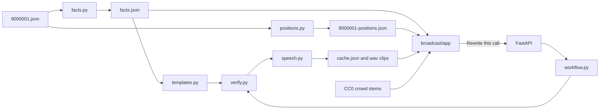

# RadioGoooal

RadioGoooal is a tape-deck broadcast of one synthetic soccer match. The deck plays minutes 87:00–92:00 of match `9000001` between Arsesnail and Mancheater City. Numbers on screen come from a precomputed fact file. The announcer lines the judges hear were synthesized once and stored in the repo. A small API can rewrite the current call. That rewrite is the only request meant to reach a model during the pitch.

## Architecture

The broadcast is a static page plus a Python package. The page does not recompute expected goals, pass quality, or the passenger fare. Those numbers are written ahead of time.



| Piece | Where | Role |
| --- | --- | --- |
| Event window | `broadcast/data/9000001.json` | Synthetic match. The deck never leaves 87:00–92:00. |
| Facts | `broadcast/facts.py`, `broadcast/data/facts.json` | One row per match second. Score, shots, expected goals, pass completion, control versus chaos, and the player card. |
| Positions | `broadcast/positions.py`, `broadcast/data/9000001-positions.json` | Reconstructed 1 Hz track, 301 frames, 11 a side. Labelled reconstructed on the pitch. |
| Lines | `broadcast/templates.py` | Play-by-play and analyst copy for six moments, five styles, three languages, and the home-fan biases. |
| Verifier | `broadcast/verify.py` | Python, not a model. Rejects an invented score, a wrong minute, a misnamed player, a real club name, or a prediction. |
| Safety | `broadcast/safety.py` | Whole-word blocklist, then Azure AI Content Safety when that resource is configured. |
| Speech cache | `broadcast/speech.py`, `broadcast/data/audio/` | 252 lines. The deck plays the wav files. It does not call Speech during playback. |
| Deck | `broadcast/app/` | Static HTML, CSS, and JavaScript. Pitch, transport, tuning, and six faders summed to mono. |
| Rewrite API | `broadcast/api/app.py`, `broadcast/workflow.py` | `GET /healthz` and `POST /rewrite`. Same routes also exist under `/api` for a linked Static Web App. |

The agent roles live in `broadcast/agents/` as YAML: interpreter, moment editor, play-by-play, analyst, and verifier. The workflow loads that YAML. Today the rewrite path fills those steps from the cached templates and the Python verifier. `healthz` reports Foundry as unconfigured until a deployment is set.

Personalization does not change a fact. Style, language, and club bias select a different cached line. The favorite player changes the card on screen. Home players are drawn in red and away players in blue. The clubs on screen are the names in the event file.

## How Azure is used

Resources are in subscription **Azure subscription 1**, resource group **radiogoooal**, region **eastus2**. The inventory and the delete command are in `broadcast/azure-resources.csv`. Delete the group after 20 Nov 2026.

Speech is not routed through Foundry. The cache build calls the Speech REST endpoint directly.

| Service | Resource | How the app uses it |
| --- | --- | --- |
| Azure AI Speech, F0 | `radiogoooal-speech` | `python tools/build_cache.py` reads neural voices from the resource, picks a short non-multilingual pair per language, and writes 252 wav clips. The build ran on 20 Oct 2026: 95,482 SSML characters, under the 100,000 stop, pass rate 1. Voices are in `broadcast/data/audio/VOICES.md`. Playback uses the files in `broadcast/data/audio/clips/`. |
| Azure AI Content Safety, F0 | `radiogoooal-safety` | After the local blocklist, `safety.py` posts the line to `contentsafety/text:analyze` when `CONTENT_SAFETY_ENDPOINT` and `CONTENT_SAFETY_KEY` are set. A category at severity 2 or higher is replaced with the template line. Without those variables the local list still runs. |
| Key Vault | `radiogoooal-kv` | `api/vault.py` reads `speech-key` and `content-safety-key` when `KEY_VAULT_URI` is set. The token comes from the container's managed identity. Region and endpoint URLs stay in environment variables. Keys are not stored in the repo. |

`SPEECH_KEY` and `SPEECH_REGION` are read only by the cache build and by `healthz`. The browser never sees a key.

These hosting pieces are prepared in the repo and are not deployed yet:

- `broadcast/Dockerfile` is the API image. It listens on port 8000.
- `broadcast/staticwebapp.config.json` sends `/` to `/app/` for Azure Static Web Apps.
- The deck calls `http://127.0.0.1:8787/rewrite` on localhost and `/api/rewrite` anywhere else, which is the path a linked Container App would receive.

Foundry is the intended model host for a live rewrite. No Foundry deployment has been created, so the rewrite button still returns the verified template.

## Run the deck locally

From the repo root:

```bash
python3 -m http.server 8765
```

Open `http://127.0.0.1:8765/broadcast/app/`. No Azure key is required. The crowd beds, the match effects, and the announcer clips are files under `broadcast/data/audio/`.

The rewrite API, from `broadcast/`:

```bash
.venv/bin/uvicorn api.app:app --port 8787
```

`GET /healthz` reports the cache version and whether Speech, Content Safety, and Foundry are configured in that process.

Tests, from `broadcast/`:

```bash
.venv/bin/pytest -q
.venv/bin/ruff check .
```
