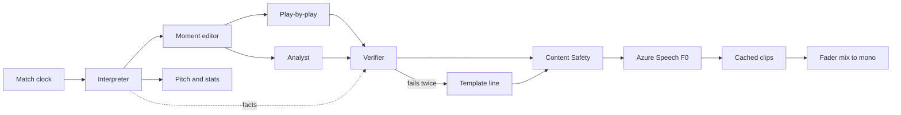

# Live radio broadcast

A five-minute radio broadcast of one synthetic match, played from a tape deck on a valve-radio cabinet. The match clock runs from 87:00 to 92:00. Judges hear a cached call, see both elevens on a reconstructed pitch, and can change announcer, club bias, and language. One live "rewrite this call" button is the only thing that hits a model during the pitch.

The on-screen clubs are **Arsesnail** and **Mancheater City**. Those are the names in the event file. The picture of the players is reconstructed, and the screen says so.

## What changed from the draft

Checked against `broadcast/data/9000001.json` and `scripts/make_synthetic_match.py` on 18 Oct 2026.

- The clubs are Arsesnail and Mancheater City. The strings "Arsenal" and "Manchester" do not appear in the file. The UI, the script cache, the video, and the README use the file's names.
- The file is derived from StatsBomb open data. `scripts/make_synthetic_match.py` stitches Premier League files `3754216` (0–30), `3754229` (30–60), and `3754340` (60–end), renames players onto invented squads, rewrites shot outcomes to 5–3, shifts each location by 0.01–3 metres, and shifts each timestamp by 0–0.1 seconds. The data card says that. Text attribution stays. The StatsBomb logo stays out of the site and the video.
- Freeze frames sit on all 43 shots and contain 8 to 18 players, so they never give both elevens. The position track supplies the missing players.
- Andrew Hornsey at 87:09 is an Arsesnail player, and the shot is off target. City's push starts at 88:05 with William Ancoats.
- Event locations are stored with the event's team attacking toward x = 120, in both halves. Both teams' goals in this file end at x = 120. The pitch uses one fixed frame and mirrors Mancheater City.
- Robert Hampstead's shot lasts 0.040 seconds over 3.18 yards, which is about 73 m/s if drawn as a flight. Shots shorter than 0.2 seconds snap. They are not interpolated.
- David Rochdale (0.270 seconds) and James Dickenson (0.343 seconds) are long enough to show a shot speed. Only Hampstead is labelled close range.
- The file continues to 94:33 with 74 further events and no further shots. Stopping at 92:00 is an editorial cut. The recap is the app's ending.
- There are no cards of any colour. Passenger fare, pass quality, and the control-versus-chaos read now have formulas.
- The speech budget is computed below. It is about 50,000 characters, under a 100,000 cap, against the F0 quota of 500,000.
- The agent workflow runs in the API container. A Foundry-hosted agent spike can replace that path only if it works in the first build week. The verifier is Python, comparing lines to the fact file.

## Demo

One match, one window. Every transport control stays inside 87:00–92:00. Playback can run straight or under the deck's fast forward. The submission video is under two minutes, so the cut jumps the three goals in this window: 87:05, 91:28, and 91:30.

| Clock | What is true | What is said |
| --- | --- | --- |
| 87:00 | Arsesnail 4, Mancheater City 1. Shots 23 and 12. Expected goals 1.15 and 1.21. | Opening. The score and the chances disagree. |
| 87:05 | Robert Hampstead scores. 5–1. Shot xG 0.43. Duration 0.040 seconds, from inside the six-yard box. | Goal. Graphic says close range and shows no speed. |
| 87:09 | Andrew Hornsey, Arsesnail, off target. xG 0.02. | Dropped. It is not part of City's push. |
| 88:05 | William Ancoats, saved. xG 0.03. | City's push begins. One note covers the next four shots. |
| 89:45 | Michael Mosley, off target. xG 0.03. | Folded into the push note. |
| 91:00 | Brian Princess, blocked. xG 0.15. | Folded into the push note. |
| 91:27 | William Ancoats, blocked. xG 0.11. | Folded into the push note. |
| 91:28 | David Rochdale scores. 5–2. xG 0.30. Duration 0.270 seconds. | Goal, with a shot speed. |
| 91:30 | James Dickenson scores. 5–3. xG 0.51. Duration 0.343 seconds. City finish on 2.34 expected goals from 18 shots. | Goal. |
| 92:00 | No later shot exists. Full-match expected goals: Arsesnail 1.60 from 25 shots, Mancheater City 2.34 from 18. | Analyst recap. The transport stops here. |

Display expected goals to two decimal places. Tests compare the raw sums, rounded to three decimals: 1.149, 1.214, 1.604, and 2.337.

Goals are never dropped by the moment editor. Club bias changes how long the analyst stays on a moment. An Arsesnail bias lengthens 87:05. A Mancheater City bias lengthens the push. A neutral bias keeps the table as written. Bias never changes a number.

## Pipeline

Rules section 4.1 is the product, in this order.

1. **Ingest.** Read the event window, the position track, and the precomputed fact file.
2. **Interpret.** Python writes the facts. The model adds one sentence of context and does not invent a number.
3. **Explain.** The moment editor keeps or drops a moment. Play-by-play and the analyst write from the kept facts, in the selected style and language.
4. **Render.** The tape deck plays the pitch, the cached voices, and the fader mix.
5. **Personalize.** Style, club bias, language, and a favorite player change the feed. The favorite player's card and heading stay on screen. The facts stay put.

## Facts

One Python package computes every number. It writes `broadcast/data/facts.json`, with one row per match second from 87:00 through 92:00. The site and the agents read that file. The browser does not recompute expected goals, pass quality, or passenger fare.

On-screen team totals are cumulative to the current second, so a scrub backward moves the score, the shots, the expected goals, and the pass completion.

### Pass quality

Every pass gets three numbers from the event file. The function and its tests live together, and the README states this formula.

- **Distance.** `pass.length` in yards. A test checks that it matches the distance from `location` to `end_location` within 0.1 yards.
- **Accuracy.** A pass with no `outcome` is complete. `Incomplete`, `Out`, `Unknown`, and `Pass Offside` are not complete. This file has 796 passes with no outcome, out of 1,038.
- **Difficulty, 0 to 100.** Weights sum to 100.
  - Distance: 34 points at 40 yards, linear below that, capped at 34.
  - Forward progress: 26 points at 30 yards of `end_x - start_x`, using the event's stored orientation, floored at zero, capped at 26.
  - Height: ground 0, low 8, high 14.
  - Under pressure: 14 if the event has `under_pressure`.
  - Cross or through ball: 12 if either boolean is set. Counted once.

The card shows the player's average difficulty across every pass they played, and their hardest completed pass. Ties go to the longer pass, then the earlier one. The interpreter hands each spell's hardest completed pass to the analyst as a fact.

### Shot speed and touch path

Shot speed is the ground distance from `location` to `end_location` (x, y only) divided by `duration`, and only when `duration` is at least 0.2 seconds. Shorter shots are labelled close range, and the graphic shows no speed.

Touch-path distance is the sum of distances between that player's successive touch locations across the whole match. Touches are observed event locations, so this number is not labelled reconstructed.

### Passenger fare

A fare is one finished 10-minute spell in which the player was on the pitch for the whole spell and recorded no touch. Spells are `[0,10), [10,20), … [90,100)`. A spell counts once its end minute has been reached. Time before a player comes on, or after they go off, is outside the count. A touch is any event where they are the actor, except Pressure and Dribbled Past.

The 80–90 spell closes at 90:00, inside the demo, so the card can tick then. The 90–100 spell does not close inside the demo window.

### Control versus chaos

For each team, over the previous 60 match seconds:

- Control events: that team's completed passes.
- Chaos events: the opponent's Pressure events, plus this team's Dispossessed and Miscontrol events.
- Index: control minus chaos. The label is control when the index is at least zero, and chaos when it is below.

### Player card

Minutes, touches, passes, completion, shots, expected goals, goals, assists, dribbles, duels, interceptions, fouls, and cards, cumulative to the current second.

An assist is the pass whose id is the `key_pass_id` of a shot with outcome Goal. This file has no `goal_assist` flag. Cards are zero for every player.

Speed, top speed, and distance covered come from the position track, for this window only, and each is labelled reconstructed. Current speed is the last step. Top speed is the largest step. Distance is the sum of the steps.

## Movement track

`broadcast/data/9000001-positions.json` covers 87:00 through 92:00 at one frame per match second. That is 301 frames. It sits next to `broadcast/data/9000001.json`, not inside the event file.

Both teams' lineups are already fixed before the window. Mancheater City move to a 4-2-3-1 at 68:08. Arsesnail move to a 4-2-3-1 at 82:30. There are no substitutions inside the window and no cards in the match, so every frame has 11 a side.

### Fixed pitch

The broadcast pitch is 120 by 80 yards. For this window Arsesnail attack toward x = 120 and defend x = 0. Mancheater City attack toward x = 0. A Mancheater City event, including its freeze frame, is mirrored with `x' = 120 - x` and `y' = 80 - y`. Arsesnail events are plotted as stored. The data card records this choice as part of the reconstruction.

### Frame

Each frame stores the match second, the ball's x and y, and each on-pitch player's id, team id, x, and y. Heading is not stored. The renderer points the arrow along the step from the previous second. A step shorter than 0.2 yards keeps the previous heading. The first frame has no arrow.

The pitch shows one frame per match second and swaps on that tick. Playback speed only changes how fast the seconds arrive. Scrubbing lands on a whole second. There is no in-between animation.

### How a frame is built

`broadcast/tools/make_positions.py --seed 9000001` writes the file. The same seed always gives the same bytes.

For each second:

1. The ball follows the active event from `location` to `end_location` across that event's duration, in the fixed frame, then holds. If the duration is under 0.2 seconds, the ball snaps to the end location and no flight is drawn.
2. The player on the ball moves with that event.
3. On a shot's second, each freeze-frame player who is currently on the pitch is sent to that frame's location.
4. Everyone else holds a 4-2-3-1 slot from the lineup above. The block sits on the side that team is defending and slides with the ball, staying goal-side of it. Each player moves at most one capped step toward the slot, so the shape drifts.

A sending-off would drop that player from the next frame onward. This match has none.

### Speed cap

No player step exceeds 10 metres per second. The conversion is `10 / 0.9144` yards per second, about 10.94. When a freeze frame or an event demands a spot farther away than that, the generator starts the player on earlier frames and walks them in a straight line under the cap. If there is not enough time, the player arrives late. The generator never teleports a player to meet a deadline.

The script writes `broadcast/data/positions-report.md`. CI reruns the generator and fails if the file changes without the seed changing. CI also fails if the frame count is not 301, if any frame is not 11 a side, or if any player step exceeds the cap. The report also lists:

- The highest player speed and the highest ball speed. Any drawn ball segment over 40 metres per second is flagged. A snap is not a segment.
- The count of frames with 11 a side, expected to be 301 of 301.
- The smallest gap between two players.
- Every late arrival, with the reason.

## Personalization

Same facts, different feed.

- **Style.** Five styles: classic radio, American broadcast, tactical, home-fan, and a spare poetic call. A style changes who talks and how. It does not change a fact. Home-fan is cached three times: Arsesnail, Mancheater City, and neutral.
- **Favorite player.** The card and the heading stay visible. The script cache is not multiplied by the squad. A favorite who is Hampstead, Rochdale, or Dickenson uses the lengthened moment already cached for that goal. Any other favorite uses the neutral lines. The rewrite button can name them.
- **Language.** English, Spanish, and Portuguese. Play-by-play and the analyst write in the selected language. They are not translated from English afterward. Each language has its own pair of Azure neural voices, one for play-by-play and one for the analyst. Facts stay in digits. The verifier checks every language the same way, and SSML speaks the numbers.

The video is in English. The language switch is shown once, with English subtitles over the Spanish call.

## Agents

Microsoft Agent Framework, as a workflow, with five roles and one orchestrator. The roles are declared in version-controlled YAML under `broadcast/agents/` and loaded by the workflow.

The workflow runs inside the API container and calls one Foundry model deployment. A short spike may try Foundry-hosted agents. If that preview is in the way, the container path is already the one the demo uses.

- **Interpreter.** Turns the fact file for this second into the bundle the other roles may use, and adds one sentence of context. Numbers are copied from the fact file.
- **Moment editor.** Decides whether this event is worth a call, and writes one sentence on why it matters. It hands off only the moments it keeps. It cannot drop a goal, and it cannot add a moment that is not in the demo table.
- **Play-by-play and analyst.** Each writes a short line in the selected style and language, using only the bundle. They run side by side. The analyst speaks only on a handoff.
- **Verifier.** Python, not a model. It checks every number, player name, club name, and clock time in the line against the bundle. A line that fails goes back to the writer once, with the mismatch named. A second failure is replaced by a template line, such as "87:05. Robert Hampstead scores. Arsesnail 5, Mancheater City 1." The verifier also rejects a prediction of the result. Each cached line stores its verdict. The README reports the share of lines that passed on the first or second try. The cache is not recorded for the video until that share is at least 95 percent.

Start on `gpt-4.1-nano`. If the Spanish or Portuguese cache misses that bar, switch the single deployment to `gpt-4o-mini`. There is one deployment either way.

Traces go to Foundry tracing and Application Insights through OpenTelemetry. A trace in the video shows the agent steps, the latency, and the verifier verdict.

### Content Safety

Every line that passes the verifier is screened with Azure AI Content Safety before it is cached or spoken. A custom blocklist matches whole words: odds, bet, accumulator, nailed on. A blocked line uses the template, and the reason is logged.

### Speech cache

Azure AI Speech, F0, called directly. The free quota is 0.5 million neural characters a month, and it throttles after that. Speech is not routed through Foundry.

The cache is the demo. Six moments, play-by-play plus analyst, is 12 lines. Seven style variants (the four non-fan styles, plus three home-fan biases) and three languages give 252 lines. At about 200 characters a line, that is about 50,000 characters. The cache build fails if it asks Speech for more than 100,000. The live rewrite is outside that budget and is used once in the pitch.

Voice short names are chosen when the cache is built, from neural voices available on the F0 resource, and written into `broadcast/data/audio/VOICES.md`.

## Audio

The mixer is six vertical faders, summed to mono, then limited at full scale.

Three crowd faders blend into one crowd bus. Each is its own CC0 loop, and the fader is that loop's gain: home roar, away roar, chant.

Three more strips:

1. Match effects. A kick on a shot, a goal kick, or a kick off. A whistle on a foul and at 92:00. A goal roar on a goal.
2. Play-by-play voice.
3. Analyst voice. The scheduler starts the analyst when play-by-play has finished. If a scrub makes them overlap, the analyst gain is multiplied by 0.25 while play-by-play is audible.

Clips are downloaded once, CC0 only, and stored in the repo with `broadcast/data/audio/ATTRIBUTION.md`. There is no Freesound API at runtime and no music bed.

## Interface

The front end is static HTML, CSS, and JavaScript in `broadcast/app/`. The reference is `mockup.zip` (`Deck-Chrome.dc.html`). It locks colour, type, and placement. The fact file locks every number and every name. Sample lines inside the mockup are a tone reference only.

The artboard is polished chrome. Walnut, pale oak, ebonised oak, honey maple, and brushed steel stay in the mockup file and are not a switcher in the app. Type is Josefin Sans for the cabinet and IBM Plex Mono for the clock, the scores, and the stats. The page background is `#0d0f11`. The cabinet max width is 1360px.

The plate reads MATCHDAY WIRELESS. The subtitle names Arsesnail, Mancheater City, synthetic match 9000001, minutes 87–92, and the polished chrome finish. An on-air lamp shows ON AIR, PAUSED, or SCANNING.

Below the plate: the transport deck. Then a row with the pitch behind dial glass and, beside it, the speaker grille, the stats panel, and the Your Player plate. Then a row with the tuning dial and the six faders. A footer attributes StatsBomb in text and the CC0 clips. There is no crest and no StatsBomb logo.

The glass scoreboard uses the file's club names. It does not say Arsenal, Man City, ARS, or MCI. Home players are `#d0402f`. Away players are `#a6d6f2`. The pitch is `#2f4a2c` with lines `#e9dcc0`. A badge on the pitch reads "Positions reconstructed · 1 Hz track". The pitch swaps frames. It does not glide. The mockup's keyframe lerp is preview scaffolding.

The tuning dial has five stops: Classic, American, Tactical, Home fan, Poetic. Language (English, Spanish, Portuguese) and club bias (Arsesnail, Mancheater City, neutral) sit in the tuning header. They do not add stops to the dial. "Rewrite this call" sits under the analyst line. Until the API exists it swaps in the other cached template and says the live rewrite waits on the API.

The Your Player plate is the full card. Clicking a dot sets the focus. The default focus is Robert Hampstead. Fader defaults are home 72, away 40, chant 58, match 80, call 92, notes 60. A tap is a hold under 250ms. Play at 92:00 restarts at 87:00.

### Transport

- **Match counter.** A flip counter from 87:00 to 92:00. It cannot leave the window.
- **Rewind and fast forward.** A tap moves 5 seconds. Holding scans at 6×. On release, play or pause returns to what it was before the scan.
- **Play and pause.** Separate keys. The active one stays pressed.
- **Scrub bar.** Lands on a whole second. Tick marks at 87:05, 91:28, and 91:30.
- **Keyboard.** Space toggles play and pause. Arrow keys mirror rewind and fast forward, including the held scan, so the recording can be driven from the keyboard.

### On-screen broadcast

The pitch, the score, the clock, both teams' shots, expected goals, pass completion, and the control-versus-chaos label. Both elevens come from that second's frame. A persistent line on the glass reads that the positions are reconstructed.

Click a player for the card defined above.

## App shape

A new app under `broadcast/` in this working repo.

- **The site** is the static page plus the cached files: the fact file, the event window, the position track, the scripts, the voice clips, and the crowd loops. Azure Static Web Apps hosts it. The demo plays from these files.
- **The API** is FastAPI on Azure Container Apps, consumption, minimum replicas 0. It serves the live rewrite and `/healthz`. A cold start delays the rewrite button only.

Local play uses the cached files and needs no keys. That is the rehearsal path.

### Submission repo

This working copy keeps the StatsBomb open-data tree so the synthetic match can be regenerated. The public submission is a separate repo. It contains the root README, `broadcast/`, `scripts/make_synthetic_match.py`, and the two match files `9000001.json` and `9000001-positions.json`. It does not contain the rest of `open-data/`.

### README for judges

The top of the submission `README.md` is written for a five-minute read.

1. A one-line pitch, the video link, and a screenshot of the tape deck.
2. The site URL, and a note that the password is in the submission form.
3. The diagram in this plan.
4. A table of which Microsoft technology does what: Foundry, Agent Framework, Speech, Content Safety, Static Web Apps, Container Apps, Key Vault, GitHub Copilot.
5. How it was built with GitHub Copilot.
6. How to run it locally from the cached files, with no keys.
7. Links to the data card, the position report, the verifier pass rate, and the audio attributions.

### Data card

`broadcast/DATA_CARD.md`, linked from the README, states:

- The match is synthetic, football-realistic data. It names `9000001.json`, the three source match ids, and what `make_synthetic_match.py` changed.
- The position track's seed, the fixed-pitch mirror, the speed cap, and where the check report lives.
- The licence for the event file, the position track, the cached scripts, and the CC0 audio.
- What is reconstructed and must not be read as observed: player positions other than the event actor and the freeze frames, player speed, and distance covered.

## Cost and access

Stay on free tiers. Generate the cache before the demo. The judge login is the paid exception.

| Piece | Choice | Why it stays cheap |
| --- | --- | --- |
| Speech | F0, called directly | About 50,000 characters against a 500,000 free quota. Foundry is not on this path. |
| Foundry | One small deployment | The script is generated once. The pitch uses the cache, plus one rewrite. |
| Content Safety | Free tier | One screen per cached line, plus the rare rewrite. |
| Static Web Apps | Standard | The paid item. Standard is what provides site-wide password protection. Cancel it after winners are announced on 20 Nov. |
| Container Apps | Consumption, min replicas 0 | The free grant covers the API. The cached demo does not wake it. |
| Freesound | Files in the repo | No runtime API. |
| Database | None | The match file, the position track, the fact file, and the cache are the store. |

Skip AKS.

### Judge login

The site stays up through the end of judging on 10 Nov 2026, 11:59 pm PT. Rules section 4.8 allows a private site if judges receive credentials.

- Turn on Static Web Apps password protection for production and staging. Judges get one shared password in the submission form.
- Link the Container App as the site's backend, so the browser calls the API through the site. Turn on Container Apps built-in authentication so the API refuses calls that do not come through the site. Confirm, during setup, that the link applies that authentication.
- If password protection is not available when the site is deployed, drop Static Web Apps, serve the page from the Container App, and use its built-in sign-in with one test account in a private Entra tenant. Give the judges that username and password. The cost is a cold start on first load.

### Secrets

No keys in the repo or in environment variables.

- The Container App has a system-assigned managed identity. Entra role assignments grant it the Foundry deployment and Content Safety.
- The Speech key lives in Key Vault, and the app reads it with the managed identity. Entra sign-in for Speech needs a custom subdomain, so Key Vault is the path this prototype uses.
- Environment variables hold only `FOUNDRY_ENDPOINT`, `SPEECH_REGION`, `CONTENT_SAFETY_ENDPOINT`, and `KEY_VAULT_URI`.
- The browser never sees a key.

### Health

`/healthz` reports whether the model deployment, Speech, and Content Safety are reachable, and which cache version is loaded.

GitHub Actions, after each deploy, loads the site with the password from a repository secret, plays the first cached clip, and calls `/healthz`.

An Azure Monitor availability test checks the site every 5 minutes and sends email if it fails. There is no recurring probe of the API, so the probe does not keep the container awake. Leave the site up until 10 Nov, and take it down after winners are announced.

## Tests and CI

`pytest` locks the interpreter against the file:

- 5–3 at 91:30, and 4–1 at 87:00.
- Expected goals at 87:00 and at full time, to three decimals, and the shot counts 23, 12, 25, and 18.
- Hampstead labelled close range. Rochdale and Dickenson produce a speed.
- The pass-quality function, including a completed pass with no outcome.
- The passenger-fare rule, including a spell that has not finished.
- The position checks: 301 frames, 11 a side, the speed cap, and the City mirror.
- Verifier rejections: an invented score, a wrong minute, a misnamed scorer, a real club name, and a prediction.

`ruff` lints the Python. The static front end has its own linter in the same workflow.

GitHub Actions, on every pull request, runs lint and tests, reruns the position generator, and fails if the committed track drifts. Deploys run from `main`.

## Built with GitHub Copilot

- `.github/copilot-instructions.md` carries the project rules: the window is 87:00–92:00, numbers come from the fact file, positions are labelled reconstructed, clubs keep the names in the file, and the site and video carry no crests, competition marks, or the StatsBomb logo.
- Custom agent files under `.github/agents/` for data, the front end, and tests.
- Build in Copilot Agent Mode, and hand well-scoped issues to the Copilot coding agent.
- Keep the pull requests Copilot opens, with their reviews, and link a few from the README.

## Build order

1. The fact package, `facts.json`, and the pytest oracles. No cloud.
2. The position generator, the report, and the drift check.
3. The static tape deck, playing the window from local files, silent.
4. Template lines, so the deck can speak before Foundry is wired.
5. The agent workflow, the verifier, Content Safety, and the Speech cache.
6. The CC0 stems and the fader mix.
7. Static Web Apps, the Container App, Key Vault, the judge password, and the smoke test.
8. The English video, under two minutes, with one language switch subtitled and one trace on screen.

## Out of scope

Playback outside 87:00–92:00. In-between animation. Generating the whole script live during the pitch. A cache entry for every player. AKS, a database, a music bed, crests, and the StatsBomb logo. Routing Speech through Foundry.

## Still open

Voice short names and Freesound ids are chosen at build time and written into the attribution files. The cabinet, the type, and the layout are locked above.
